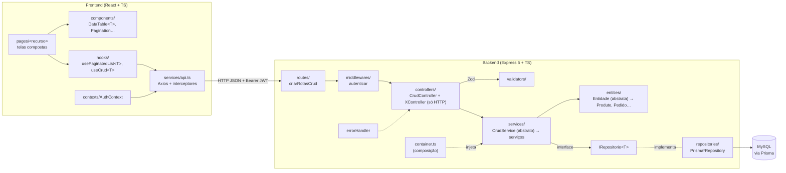
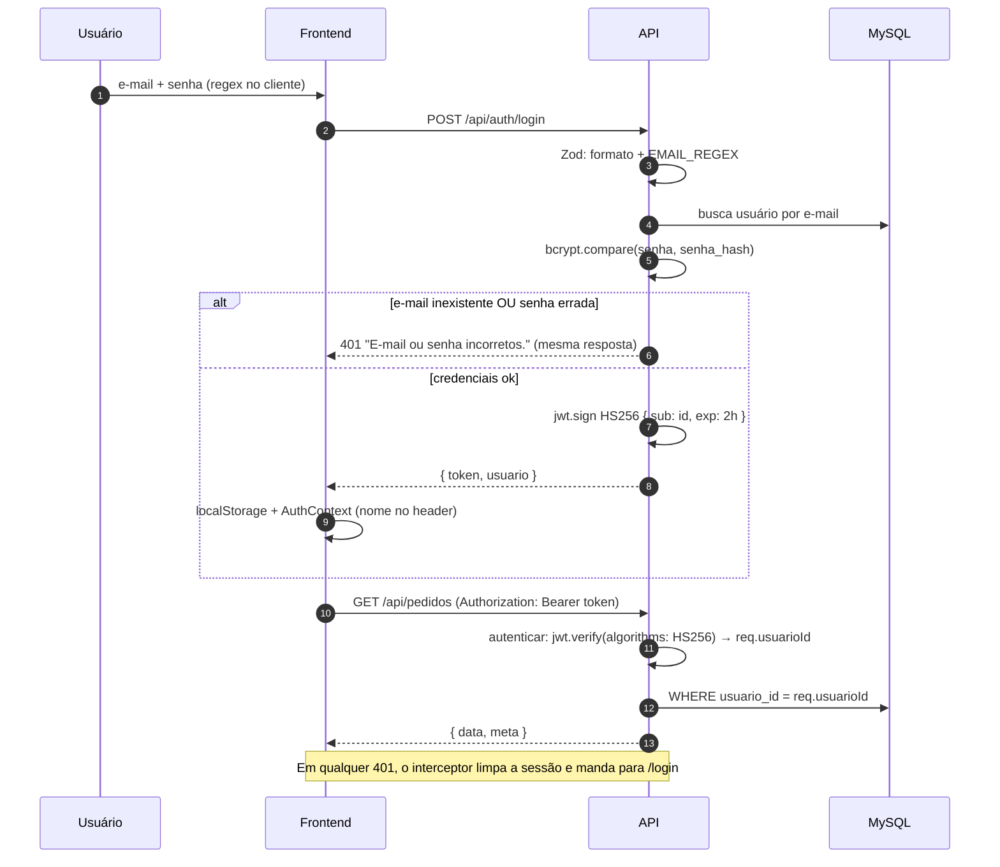

# Defesa técnica — Solutec (Sprint 2)

Roteiro de cerca de **10 minutos** para a banca. Os caminhos citados são relativos a `backend/src/` ou `frontend/src/`, e as linhas correspondem ao commit de entrega.

| Tempo | Bloco | Mostrar |
|---|---|---|
| 0:00–1:00 | Problema e persona | `docs/PERSONA.md`: dores do Ricardo → funcionalidades |
| 1:00–2:30 | Arquitetura em camadas | Diagrama abaixo + pastas do backend |
| 2:30–4:00 | Autenticação JWT | Fluxo abaixo + demo de login e rota protegida |
| 4:00–7:00 | POO, TypeScript e SOLID | Tabela "onde está cada pilar" (abrir 3 ou 4 arquivos) |
| 7:00–8:30 | Demo dos CRUDs | Criar pedido → preço congelado → transição de status inválida (422) |
| 8:30–9:30 | Dados e decisões | `docs/analise-estatistica.md` (métricas de negócio) e `docs/DECISOES.md` |
| 9:30–10:00 | Qualidade | `npm test` (119 testes), Bruno, `AGENTS.md` e skills |

## 1. Arquitetura em camadas

- **Controller** só traduz HTTP: lê params, query e body, valida com Zod e escolhe o status code (`controllers/CrudController.ts:16`); cada recurso tem seu controller que herda dele (`controllers/CategoriaController.ts:7`) e seu arquivo de rotas (`routes/categoria.routes.ts:5`).
- **Service** guarda a regra de negócio e não conhece Express nem Prisma (`services/CrudService.ts:25`).
- **Repository** só persiste e devolve entidades de domínio (`repositories/PrismaCategoriaRepository.ts:11`).
- **Entity** valida o próprio estado: um `Produto` com preço negativo não chega a existir (`entities/Produto.ts:63`).

## 2. Fluxo do JWT

| Passo | Onde |
|---|---|
| Regex de e-mail (Zod) | `validators/email.ts:5`, `validators/auth.validator.ts:12` |
| `bcrypt.compare` | `services/passwordHasher.ts:20` (chamado por `entities/Usuario.ts:60`: o hash não sai da entidade) |
| 401 idêntico + bcrypt contra hash fictício | `services/AutenticarUsuarioService.ts:32` |
| Assinatura HS256 com `sub` e `expiresIn` | `services/JwtTokenService.ts:31` |
| Verificação restrita a HS256 | `services/JwtTokenService.ts:40` |
| Middleware + `req.usuarioId` | `middlewares/autenticar.ts:6`, `types/express.d.ts:5` (declaration merging) |
| `JWT_SECRET` ≥ 32 caracteres | `config/env.ts:10` |
| Todas as rotas de CRUD autenticadas | `routes/crud.routes.ts:10` |
| Front: token no localStorage | `services/authStorage.ts:42` |
| Front: interceptor (Bearer + 401) | `services/api.ts:13`, `services/api.ts:21` |
| Front: rota protegida | `components/ProtectedRoute.tsx:6`, `routes/AppRoutes.tsx:30` |

## 3. Onde está cada pilar

### POO

| Pilar | Evidência |
|---|---|
| **Encapsulamento** (`#campos` + construtor que valida) | `entities/Produto.ts:39` (`#preco`), `entities/Usuario.ts:27` (`readonly #email`), `entities/Pedido.ts:59` (`get itens` devolve uma cópia) |
| **Getter/setter com critério** | `set preco` valida > 0 e 2 casas (`entities/Produto.ts:63`); `set estoque` valida inteiro ≥ 0 (`entities/Produto.ts:78`); `get total` calculado, sem setter (`entities/Pedido.ts:64`); `get disponivel` derivado (`entities/Produto.ts:86`). Os demais campos mudam só por métodos com regra (`alterarCpf`, `entities/Usuario.ts:51`) |
| **Herança + classe abstrata** | `abstract class Entidade` (`entities/Entidade.ts:17`) com `abstract paraResposta()` (`entities/Entidade.ts:52`), estendida por `Usuario` (`entities/Usuario.ts:24`), `Categoria` (`entities/Categoria.ts:20`), `Produto` (`entities/Produto.ts:36`), `Endereco` (`entities/Endereco.ts:36`) e `Pedido` (`entities/Pedido.ts:38`) |
| **Template method** | `abstract class CrudService` (`services/CrudService.ts:25`): fluxo fixo em `atualizar` (`services/CrudService.ts:49`) e ganchos abstratos (`services/CrudService.ts:83`) |
| **Polimorfismo por sobrescrita** | `CategoriaService.validarRemocao` → 409 (`services/CategoriaService.ts:19`); `EnderecoService.escopo` → ownership (`services/EnderecoService.ts:13`); `PedidoService.validarRemocao` → 422 (`services/PedidoService.ts:51`) |
| **Composição / objeto de valor** | `ItemPedido` dentro do agregado `Pedido` (`entities/ItemPedido.ts:25`) |

### TypeScript avançado

| Recurso | Evidência |
|---|---|
| `interface` para contratos | `IRepositorio<T, TId>` (`repositories/IRepositorio.ts:14`), `IServicoCrud` (`services/CrudService.ts:12`), `PasswordVerifier` (`services/passwordHasher.ts:10`) |
| `type` para DTOs e unions | `StatusPedido` (`entities/StatusPedido.ts:4`), `UF` (`entities/Endereco.ts:9`) |
| Utility types | `Omit` (`entities/Produto.ts:16`, `entities/Endereco.ts:26`), `Pick` (`entities/Pedido.ts:17`), `Partial<Pick<…>>` (`entities/Pedido.ts:21`) |
| Generics | `Paginado<T>` (`types/paginacao.ts:13`), `CrudService<TEntidade, TCriar, TAtualizar, TResposta>`, `DataTable<T>` (front `components/DataTable.tsx:23`), `usePaginatedList<T>` (front `hooks/usePaginatedList.ts:17`), `useCrud<T>` (front `hooks/useCrud.ts:13`) |
| Zero `any` | `strict`, `noUncheckedIndexedAccess` e `exactOptionalPropertyTypes`; dados de fora entram como `unknown` e passam por narrowing (`validators/usuario.validator.ts:60`) |

### SOLID

| Princípio | Evidência |
|---|---|
| **S**: responsabilidade única | controller só HTTP (`controllers/CrudController.ts:23`), service só regra, repository só persistência (`repositories/PrismaCategoriaRepository.ts:11`) |
| **O**: aberto/fechado | Tabela `REGRAS_STATUS` (`services/pedido/transicoesStatus.ts:17`): um status ou transição nova é uma linha na tabela, sem `if` encadeado; `alterarStatus` só consulta a tabela (`entities/Pedido.ts:76`) |
| **L**: substituição de Liskov | O teste `deveResponder404` recebe o tipo **abstrato** `CrudService` e roda com os 4 serviços concretos (`backend/tests/CrudService.test.ts:29`); o fluxo completo também roda pela referência à base (`backend/tests/CrudService.test.ts:64`) |
| **I**: segregação de interfaces | `PasswordHasher` (cadastro) separado de `PasswordVerifier` (login) (`services/passwordHasher.ts:10`) |
| **D**: inversão de dependência | Services recebem interfaces no construtor; só o `container.ts` instancia Prisma, bcrypt e JWT (`container.ts:31`, `container.ts:55`). Os testes trocam o Prisma por `RepositorioMemoria` sem mudar o serviço |

### Exceções e organização

- Hierarquia: `abstract class AppError` (`errors/AppError.ts:4`) → `ValidationError` 400, `UnauthorizedError` 401 (`:22`), `NotFoundError` 404 (`:34`), `ForbiddenError` 403 (`:40`), `ConflictError` 409, `BusinessRuleError` 422 (`:47`).
- O `errorHandler` traduz cada uma, agrupa os erros do Zod por campo, converte erros do Prisma (P2002/P2003/P2025) em respostas genéricas e transforma o resto em 500 sem detalhes (`middlewares/errorHandler.ts:63`).
- Pastas: `entities/ services/ repositories/ controllers/ routes/ middlewares/ errors/ validators/`; classes em PascalCase, funções em camelCase.

## 4. Decisões que valem citar

Todas estão em [`DECISOES.md`](DECISOES.md). As mais prováveis de aparecer na conversa:

- **D2**: mesma resposta 401 para e-mail inexistente e senha errada.
- **D6/D7**: total calculado (não gravado) e preço congelado no item.
- **D8**: pedido não baixa estoque (checkout fora do escopo).
- **D9**: tabela de transições de status.
- **D11/D12**: 409 para preservar histórico; 404 para recurso de outro dono.
- **D14**: rota pública `GET /api/catalogo` só para a vitrine.

## 5. Perguntas prováveis da banca

1. **"Por que o total do pedido não é uma coluna no banco?"**
   Para nunca divergir dos itens. É um getter (`Pedido.total`) que soma os subtotais em centavos. O que fica gravado é o **preço unitário congelado** de cada item, então o total é reproduzível.

2. **"Como você garante que um usuário não vê o pedido de outro?"**
   O id do usuário vem só do token (`req.usuarioId`). O `CrudService` pede ao serviço concreto um `escopo`, e o repositório coloca `usuario_id` no `WHERE`. Recurso de outro dono responde 404, igual a inexistente, sem vazar existência. Há teste para isso.

3. **"Onde está o polimorfismo de verdade, e não só herança?"**
   No `CrudService`: o método `remover` é o mesmo para todos, mas `validarRemocao` se comporta diferente em cada subclasse (categoria com produtos → 409, pedido pago → 422, endereço em pedido → 409). O teste de Liskov chama os quatro serviços pelo tipo abstrato.

4. **"Por que não usar `if` para as regras de status?"**
   Open/Closed. As regras estão em `REGRAS_STATUS` (próximos status, se é editável, se é removível). Criar um status `DEVOLVIDO` é acrescentar uma linha na tabela; nem o serviço nem a entidade mudam.

5. **"O JWT no localStorage não é inseguro?"**
   É um trade-off consciente para o escopo acadêmico: é simples e funciona com a API separada do front. As mitigações são expiração de 2h, `HS256` fixado na verificação (impede `alg: none`), segredo com ≥ 32 caracteres validado no boot, nenhum dado sensível no payload, nenhum `dangerouslySetInnerHTML` (reduz XSS) e limpeza da sessão em qualquer 401. Em produção, o próximo passo seria cookie `httpOnly` + `SameSite`.

**Bônus**: *"Por que o e-mail não pode ser alterado?"* Porque é o login. A entidade não tem método para trocá-lo (`readonly #email`), e o `PUT /me` com `email` responde 400 antes de chegar ao serviço (`validators/usuario.validator.ts:60`).
