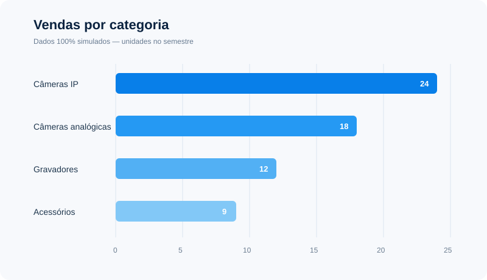
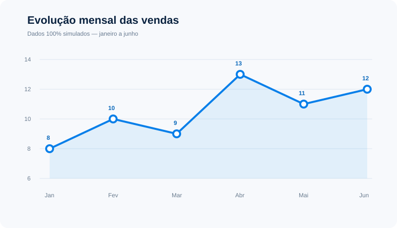
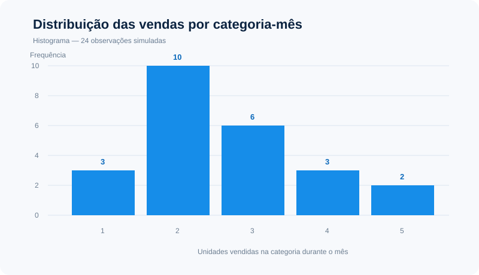
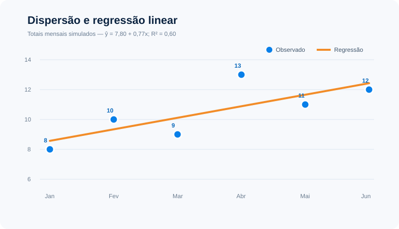
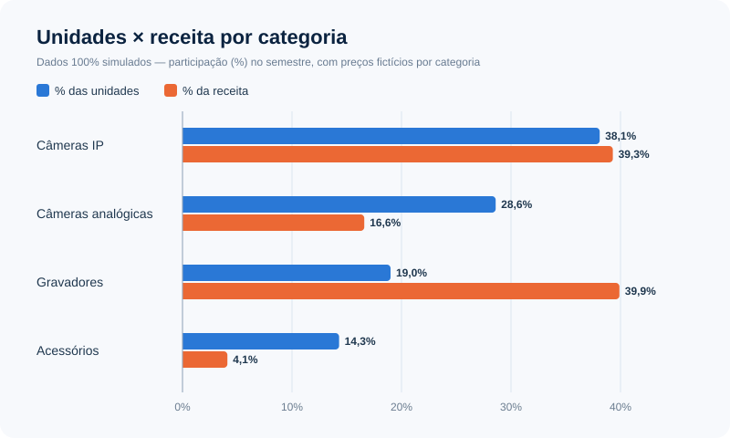

# Análise descritiva — comércio de câmeras de segurança

> **Aviso acadêmico:** todos os dados desta análise são 100% fictícios e foram criados apenas para demonstrar conceitos de Probabilidade e Estatística. Eles não representam vendas, faturamento, desempenho ou qualquer resultado real da Solutec.

## Conjunto demonstrativo

Foram simuladas 63 unidades vendidas entre janeiro e junho, distribuídas entre quatro categorias. A base completa e reproduzível está em [`dados-simulados.csv`](dados-simulados.csv).

| Mês | Câmeras IP | Câmeras analógicas | Gravadores | Acessórios | Total |
|---|---:|---:|---:|---:|---:|
| Janeiro | 3 | 2 | 2 | 1 | 8 |
| Fevereiro | 4 | 3 | 2 | 1 | 10 |
| Março | 3 | 3 | 2 | 1 | 9 |
| Abril | 5 | 4 | 2 | 2 | 13 |
| Maio | 4 | 3 | 2 | 2 | 11 |
| Junho | 5 | 3 | 2 | 2 | 12 |

## Vendas por categoria

No semestre simulado, câmeras IP somam 24 unidades (38,1%), câmeras analógicas 18 (28,6%), gravadores 12 (19,0%) e acessórios 9 (14,3%). A categoria de câmeras IP é a mais frequente nesse cenário hipotético.

## Evolução mensal

Os totais mensais simulados são: 8, 10, 9, 13, 11 e 12 unidades.

- **Média:** (8 + 10 + 9 + 13 + 11 + 12) ÷ 6 = **10,5 unidades por mês**.
- **Mediana:** ordenando os valores (8, 9, 10, 11, 12, 13), a média dos dois valores centrais é (10 + 11) ÷ 2 = **10,5 unidades**.

A igualdade entre média e mediana indica que, neste conjunto pequeno e simulado, não há valor extremo deslocando o centro da distribuição. A série oscila, com pico hipotético em abril (13) e menor valor em janeiro (8); seis observações não permitem concluir tendência ou sazonalidade.

## Histograma das observações por categoria e mês

Para observar a distribuição sem agregar as categorias, foram usadas as 24 combinações de categoria e mês. A frequência é 3 observações com 1 unidade, 10 com 2 unidades, 6 com 3 unidades, 3 com 4 unidades e 2 com 5 unidades. A maior concentração está entre 2 e 3 unidades por categoria-mês, somando 16 das 24 observações (66,7%).

## Dispersão e regressão linear

O gráfico relaciona o índice do mês (janeiro = 1 até junho = 6) ao total vendido. A regressão linear simples resulta em **ŷ = 7,80 + 0,77x**, o que representa aumento estimado de 0,77 unidade por mês nesse recorte. O coeficiente de determinação é **R² = 0,60**: aproximadamente 60% da variação dos seis totais é explicada pela tendência linear. Por se tratar de uma amostra curta e fictícia, o resultado é apenas descritivo e não deve ser usado como previsão real.

## Métricas de negócio

> Os preços abaixo também são **fictícios** e servem só para transformar as unidades simuladas em receita. Não são preços praticados pela Solutec.

| Categoria | Preço médio fictício | Unidades | Receita estimada | % das unidades | % da receita |
|---|---:|---:|---:|---:|---:|
| Câmeras IP | R$ 320,00 | 24 | R$ 7.680,00 | 38,1% | 39,3% |
| Câmeras analógicas | R$ 180,00 | 18 | R$ 3.240,00 | 28,6% | 16,6% |
| Gravadores | R$ 650,00 | 12 | R$ 7.800,00 | 19,0% | 39,9% |
| Acessórios | R$ 90,00 | 9 | R$ 810,00 | 14,3% | 4,1% |
| **Total** | | **63** | **R$ 19.530,00** | 100% | 100% |

Receita estimada = unidades × preço médio fictício. Participação = receita da categoria ÷ receita total.

Barras agrupadas mostram as duas participações lado a lado, na mesma escala (%). A comparação que importa é **dentro de cada categoria**: unidades contra receita.

### Ticket médio

Como a base simulada registra unidades (e não pedidos), considera-se cada unidade como uma venda. Assim, **ticket médio = receita ÷ unidades vendidas**.

- Semestre: R$ 19.530,00 ÷ 63 = **R$ 310,00 por venda**.
- Por mês: janeiro R$ 338,75; fevereiro R$ 321,00; março R$ 321,11; abril R$ 292,31; maio R$ 300,00; junho R$ 301,67.

O volume cresce (8 → 12 unidades), mas o ticket médio cai cerca de 11% entre janeiro e junho. Os gravadores ficam fixos em 2 unidades por mês e passam a pesar menos no total, enquanto câmeras analógicas e acessórios, mais baratos, crescem.

### Variação mês a mês da receita

| Mês | Unidades | Receita estimada | Variação vs. mês anterior |
|---|---:|---:|---:|
| Janeiro | 8 | R$ 2.710,00 | — |
| Fevereiro | 10 | R$ 3.210,00 | +18,5% |
| Março | 9 | R$ 2.890,00 | −10,0% |
| Abril | 13 | R$ 3.800,00 | +31,5% |
| Maio | 11 | R$ 3.300,00 | −13,2% |
| Junho | 12 | R$ 3.620,00 | +9,7% |

Variação = (receita do mês − receita do mês anterior) ÷ receita do mês anterior. A série alterna altas e quedas, com pico em abril. A receita de junho é 33,6% maior que a de janeiro.

### Da métrica à decisão

| Métrica | O que mostra (no cenário fictício) | Decisão que apoia | Tipo |
|---|---|---|---|
| Receita por categoria | Gravadores são 19% das unidades, mas 39,9% da receita. | Nunca deixar gravador faltar: estoque mínimo maior e reposição antecipada (alerta de estoque baixo na tela de produtos). | **Estoque** |
| Participação na receita | Acessórios são 14,3% das unidades e só 4,1% da receita. | Vender acessório junto com câmera (kits) em vez de dar desconto avulso. | **Promoção** |
| Participação (unidades × receita) | Analógicas vendem bem (28,6%), mas rendem menos (16,6%). | Rever o mix: destacar câmeras IP no catálogo e usar as analógicas como entrada de preço. | **Mix** |
| Ticket médio | Caiu de R$ 338,75 para cerca de R$ 300 enquanto o volume subiu. | Oferecer *upgrade* (analógica → IP, câmera avulsa → kit com DVR) para recuperar o ticket. | **Promoção / mix** |
| Variação mês a mês | Picos alternados, com o maior em abril (+31,5%). | Reforçar o estoque de câmeras IP e gravadores antes de abril e não ler uma queda isolada como tendência. | **Estoque** |

No sistema, essas decisões usam dados que os CRUDs já guardam: preço e estoque (Produtos), agrupamento (Categorias) e itens com preço congelado e status (Pedidos). Com pedidos reais, o ticket médio passa a ser calculado por pedido (`total` ÷ número de pedidos) e não por unidade.

## Possível apoio a decisões comerciais

Em uma operação real, análises semelhantes poderiam ajudar a estimar demanda por categoria, planejar estoque, identificar meses de maior procura e avaliar a composição das vendas. Decisões confiáveis exigiriam uma série histórica maior, dados reais validados e métricas adicionais, como receita, margem, devoluções e estoque disponível.
