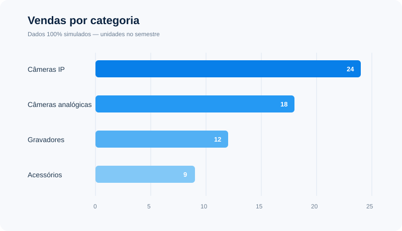
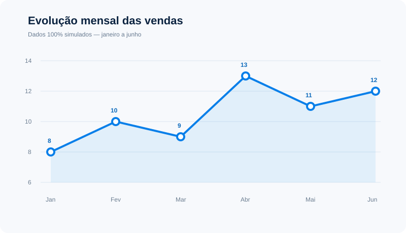
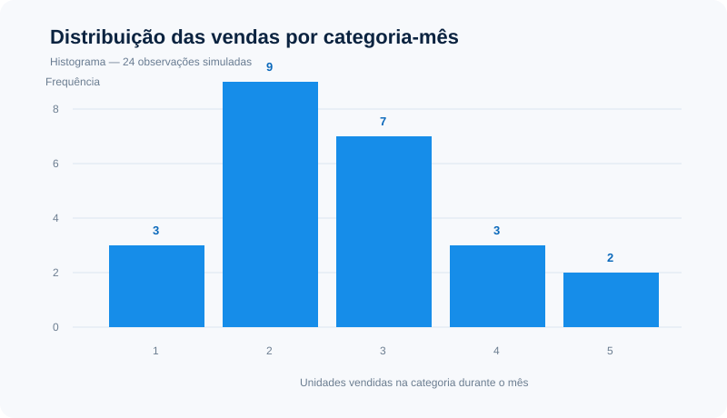
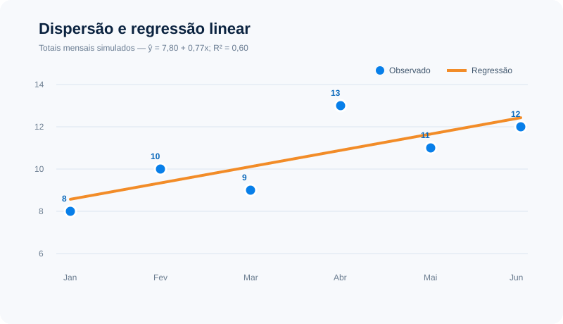

# Análise descritiva — comércio de câmeras de segurança

> **Aviso acadêmico:** todos os dados desta análise são 100% fictícios e foram criados apenas para demonstrar conceitos de Probabilidade e Estatística. Eles não representam vendas, faturamento, desempenho ou qualquer resultado real da Solutec.

## Conjunto demonstrativo

Foram simuladas 63 unidades vendidas entre janeiro e junho, distribuídas entre quatro categorias. A base completa e reproduzível está em [`dados-simulados.csv`](dados-simulados.csv).

| Mês | Câmeras IP | Câmeras analógicas | Gravadores | Acessórios | Total |
|---|---:|---:|---:|---:|---:|
| Janeiro | 3 | 2 | 2 | 1 | 8 |
| Fevereiro | 4 | 3 | 2 | 1 | 10 |
| Março | 3 | 3 | 2 | 1 | 9 |
| Abril | 5 | 4 | 2 | 2 | 13 |
| Maio | 4 | 3 | 2 | 2 | 11 |
| Junho | 5 | 3 | 2 | 2 | 12 |

## Vendas por categoria

No semestre simulado, câmeras IP somam 24 unidades (38,1%), câmeras analógicas 18 (28,6%), gravadores 12 (19,0%) e acessórios 9 (14,3%). A categoria de câmeras IP é a mais frequente nesse cenário hipotético.

## Evolução mensal

Os totais mensais simulados são: 8, 10, 9, 13, 11 e 12 unidades.

- **Média:** (8 + 10 + 9 + 13 + 11 + 12) ÷ 6 = **10,5 unidades por mês**.
- **Mediana:** ordenando os valores (8, 9, 10, 11, 12, 13), a média dos dois valores centrais é (10 + 11) ÷ 2 = **10,5 unidades**.

A igualdade entre média e mediana indica que, neste conjunto pequeno e simulado, não há valor extremo deslocando o centro da distribuição. A série oscila, com pico hipotético em abril (13) e menor valor em janeiro (8); seis observações não permitem concluir tendência ou sazonalidade.

## Histograma das observações por categoria e mês

Para observar a distribuição sem agregar as categorias, foram usadas as 24 combinações de categoria e mês. A frequência é 3 observações com 1 unidade, 9 com 2 unidades, 7 com 3 unidades, 3 com 4 unidades e 2 com 5 unidades. A maior concentração está entre 2 e 3 unidades por categoria-mês, somando 16 das 24 observações (66,7%).

## Dispersão e regressão linear

O gráfico relaciona o índice do mês (janeiro = 1 até junho = 6) ao total vendido. A regressão linear simples resulta em **ŷ = 7,80 + 0,77x**, o que representa aumento estimado de 0,77 unidade por mês nesse recorte. O coeficiente de determinação é **R² = 0,60**: aproximadamente 60% da variação dos seis totais é explicada pela tendência linear. Por se tratar de uma amostra curta e fictícia, o resultado é apenas descritivo e não deve ser usado como previsão real.

## Possível apoio a decisões comerciais

Em uma operação real, análises semelhantes poderiam ajudar a estimar demanda por categoria, planejar estoque, identificar meses de maior procura e avaliar a composição das vendas. Decisões confiáveis exigiriam uma série histórica maior, dados reais validados e métricas adicionais, como receita, margem, devoluções e estoque disponível.
